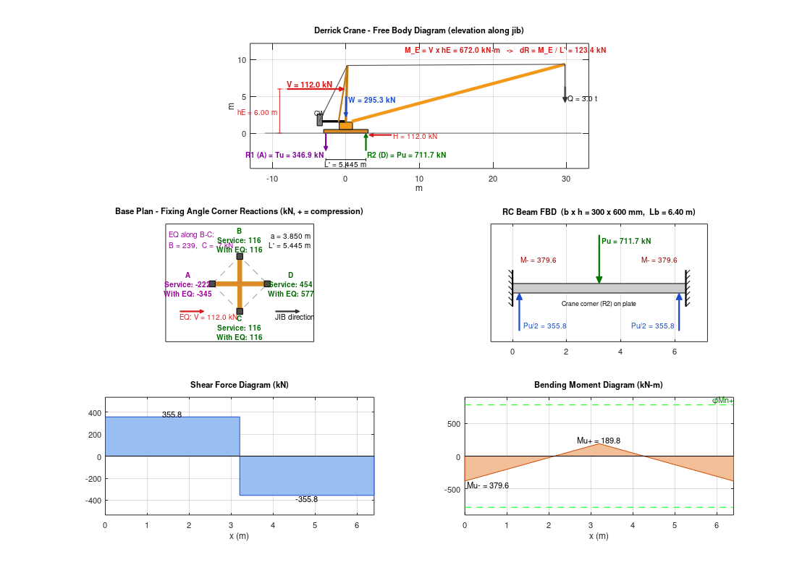

# Derrick Crane Support Design (MATLAB)

MATLAB version of the **"LCR352 Derrick Crane Support Design Note Rev00"** Excel
template (sheets *Derrick Crane Beam* and *Derrick Crane Slab*). It adds an
**NSCP 2015 earthquake check**: the base shear is calculated automatically, and
**you enter the height above the crane base where it acts (hE)**.



## Files

| File | Purpose |
|---|---|
| `DerrickCraneApp.m` | GUI (uifigure): input panels, Calculate / Export / Reset, FBD tabs, result tables, report |
| `derrickCraneCalc.m` | Calculation engine (no GUI); returns a struct + text report |
| `nscpSeismic.m` | NSCP 2015 base shear: static, simplified, equipment-on-structure (Fp) |
| `derrickCraneDefaults.m` | Default inputs taken from the Excel sheets (`'Beam'` / `'Slab'`) |
| `validateAgainstExcel.m` | Reproduces every Excel result (23 values) to 1e-6 |

## Run

```matlab
cd matlab/DerrickCrane
DerrickCraneApp            % GUI (MATLAB R2020b+)
validateAgainstExcel       % engine vs. Excel check
R = derrickCraneCalc(derrickCraneDefaults('Slab'));  disp(char(R.report))
```

## What the program does

1. **Loads**: plate self weight `Pd = l·w·t·7850·9.81`, crane corner reactions `Pc` and `Pt`
   (TD3030-16 presets from the manufacturer's tables).
2. **Earthquake**: `W = crane + counterweight (+ % of hook load)`, then V from NSCP 2015.
   `M_E = V·hE` (**hE is your input**) gives `dR = M_E / L'`, where `L' = a·√2` is the
   diagonal between corners A (uplift) and D (compression). The manufacturer's
   `L = 5445 mm` equals `3850·√2`, so the template's "support distance" is that diagonal.
   The base shear is shared by the four corners, `H = V/4` (bolt shear).
3. **Combinations**: template `Tu = kt·Pt`, `Pu = 1.4Pd`, `Pu = 1.2Pd + kc·Pc`, plus
   `Tu = kEQ·Pt + dR − 0.9Pd` and `Pu = 1.2Pd + kEQ·Pc + dR`. The larger value governs.
4. **Checks**
   - Beam: bolt tension, bolt shear and tension–shear interaction, mortar bearing, beam shear, flexure (+/−).
   - Slab: bolt checks, slab shear under uplift, floors to back-prop, shores per floor.
5. **FBDs**: crane elevation (W, Q, V at hE, H, R1/R2), base plan with service and EQ corner
   reactions, and the beam FBD with SFD/BMD or the slab plate, back-propping stack and shore chart.

## Calculation basis switch

`template` reproduces the Excel sheet exactly. `refined` uses code-consistent
alternatives for the items flagged below.

## Items found in the Excel template (please review)

| # | Sheet | Item | Template | Refined option |
|---|---|---|---|---|
| 1 | Beam vs Slab | Crane factor on Pc | Beam `1.25·1.25·Pc`, Slab `1.25·Pc` | input `kc` (set consistently) |
| 2 | Beam | Moment for a point load at mid-span of a fixed-fixed beam | `PL/12`, `PL/24` (these are UDL coefficients) | `PL/8` for both. **Template under-estimates by 1.5× / 3×** |
| 3 | Beam | Flexural capacity | `0.9·As·fy·d` (no `a/2`) | `0.9·As·fy·(d − a/2)` |
| 4 | Beam | `Vc` uses `h` instead of `d` | `0.17√f'c·b·h` | `0.17√f'c·b·d` |
| 5 | Beam | `Vs` uses one stirrup leg | Av = 1 leg | input "Stirrup legs" |
| 6 | Beam | "Non-shrink mortar" self weight uses steel density 7850 | — | (label only) |
| 7 | Slab | Shear line `bw = 2·l·w` (units m², not a perimeter) | 2.88 | `bo = 2(l+d)+2(w+d)`, `0.33√f'c` two-way |
| 8 | Slab | Slab capacity per floor hard-coded `75·4/5.5` | 54.5 kN | editable input |
| 9 | Both | No earthquake / lateral load | — | NSCP 2015 added |

With the refined basis the beam shear DCR is just over 1.0 (1.007) at the template inputs.

## Earthquake notes

- **static** (default): `V = CvIW/(RT)`, limited to `2.5CaIW/R` and at least `0.11CaIW`
  (Zone 4: at least `0.8ZNvIW/R`), with `T = Ct·hn^¾`. R = 2.9 ("other self-supporting
  structures") is an assumption; set your own.
- **equipment**: `Fp = ap·Ca·Ip/Rp·(1+3hx/hr)·Wp`. For a crane at roof level (hx = hr) and
  ap = 2.5 this gives about 1.47 W, roughly 4× the static value, and governs most checks.
  Choose the method your project's design criteria require.
- The EQ is assumed to act in the same direction as the jib overturning (conservative).
  The B–C direction is reported too, and side corner C can go into uplift.
- Check the equation and table numbers against your copy of NSCP 2015.
